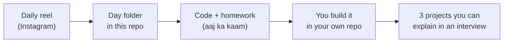

# AI Engineer in 42 Days · Lala Se Lab Tak

**One reel, one project step and the day's code. Every day, for 42 days.**

A free, project-first path from an IT job (support, testing, ops, development) to an **AI Engineer** role, taught in Hinglish through the Instagram series *Lala Se Lab Tak* by [DevWithData](https://devwithdata.com).

> Job ki guarantee koi nahi deta. Hum plan aur proof dete hain.
> Nobody can guarantee you a job. This repo gives you a plan, and the proof you build with it.

## Start here

1. **[Day 0 · The launch](days/day-00-launch)**: why this exists and how it works.
2. **[Day 1 · The full roadmap](days/day-01-roadmap)**: all 42 days, the 3 projects, and how to track your progress.
3. **Follow [@dev_with_data](https://www.instagram.com/dev_with_data/) on Instagram** for the daily reel, then open that day's folder here.

## How it works



## The 6 weeks

| Week | Focus | What you learn | Days |
|---|---|---|---|
| 1 | Python basics | Setup, variables, lists, loops, files | Days 1 to 7 |
| 2 | LLM APIs + Project 1 | APIs, tokens, prompts, JSON output, Ticket Summarizer | Days 8 to 14 |
| 3 | RAG + Project 2 | Embeddings, chunking, vector and hybrid search, Policy Bot | Days 15 to 21 |
| 4 | Evals and safety | Hallucination, eval set, score, cost, prompt injection | Days 22 to 28 |
| 5 | Agents + Project 3 | Tool calling, MCP, Repair Booking Agent, guardrails | Days 29 to 35 |
| 6 | Ship and get interview-ready | Deploy, READMEs, resume, LinkedIn, interviews | Days 36 to 42 |

## The 3 projects

| Project | When | What it does |
|---|---|---|
| [P1 · Ticket Summarizer](projects/p1-ticket-summarizer) | Days 8 to 14 | Reads support tickets and returns category, priority and a short summary as JSON. |
| [P2 · Lala Policy Bot (RAG)](projects/p2-policy-bot-rag) | Days 15 to 28 | Answers questions from public sample policy documents, shows the source page, and reports a measured eval score. |
| [P3 · Repair Booking Agent](projects/p3-repair-booking-agent) | Days 29 to 35 | A chat agent that books a repair slot with tools, asks a human before confirming, and stops safely. |

## Follow along

- **Star** this repo so it shows up in your GitHub, and **watch** it to get the daily update.
- Make **your own repo** for your work (for example `my-42-days-ai`). Push your homework there every day: that commit history is your proof.
- Each day folder has a `README.md` (what, why, the task) and, from Day 3, code you can run.
- Stuck? Comment on that day's reel. Found a bug? Open an issue here.

## Repo layout

```text
ai-engineer-42-days-challenge/
├── days/
│   ├── day-00-launch/        why this exists, how it works
│   ├── day-01-roadmap/       the full 42-day plan
│   └── day-02 ... day-42/    one folder per day (filled in on that day)
├── projects/
│   ├── p1-ticket-summarizer/
│   ├── p2-policy-bot-rag/
│   └── p3-repair-booking-agent/
├── data/                     sample and public data only
└── .env.example              copy to .env for your own keys (never commit .env)
```

## Ground rules

- **No job or salary promises.** Your results depend on your work, your market and your interviews.
- **Sample and public data only.** Never paste company data, customer data or real tickets into any code or AI tool.
- **Keys stay secret.** Put API keys in `.env`. It is in `.gitignore` for a reason.
- **Prices and free tiers change.** Anything about cost or free tiers is checked on the day it is posted. Verify again before you rely on it.

## About

Made by **Shashikant (Dev)**, Senior Engineering Lead at an MNC, working on AI, with 8 years in IT. *DevWithData* is where I teach it in Hindi and Hinglish.
The reels are scripted, voiced and edited with help from AI. The code, the plan and the experience are mine.

Licensed under the [MIT License](LICENSE).
