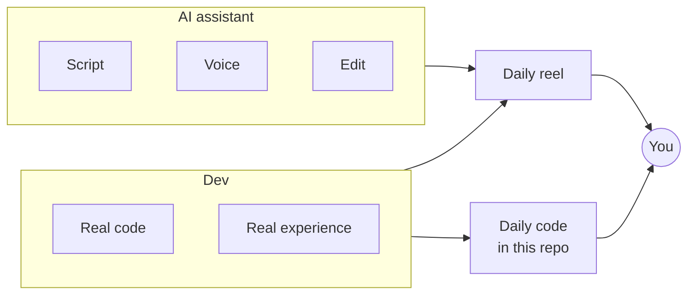
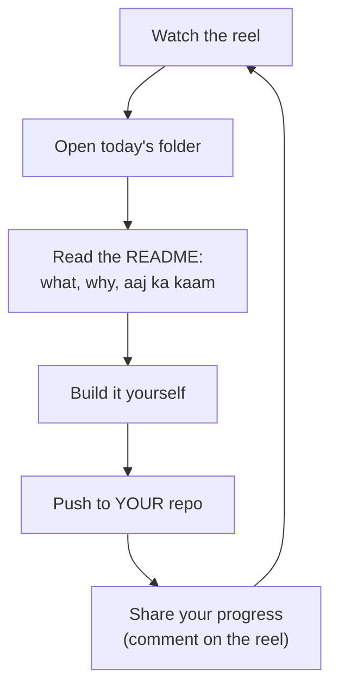

# Day 0 · The launch

> *200 apply. 0 call. Aur sab bol rahe hain "market khatam".*

This is where the challenge starts. If you came here from the launch reel, welcome.

## Why this exists

The job market is rough, and "AI will take your job" is everywhere. But in the same market, recruiters were reaching out to me for **Senior AI Engineer** and **GenAI Specialist** roles. Not because of certificates. Because of **real projects on GitHub that I could explain line by line**.

People kept asking me on LinkedIn: *kaise kiya?* So this repo is the answer, one day at a time.

## The deal: Dev + AI

Between office work and hackathons, I had no time to shoot and edit tutorials. So I made a deal with my AI assistant:

## What you get, every day

| Every day | Where |
|---|---|
| 1 reel (about 60 s, Hinglish) | Instagram [@dev_with_data](https://www.instagram.com/dev_with_data/) |
| 1 project step | that day's folder in `days/` |
| The day's code | here, on GitHub |

## The daily loop

## How to join

1. Follow [@dev_with_data](https://www.instagram.com/dev_with_data/) for Day 1.
2. Star this repo and watch it for daily updates.
3. Read **[Day 1 · The full roadmap](../day-01-roadmap)**.

> Job ki guarantee koi nahi deta. Hum plan aur proof dete hain.
