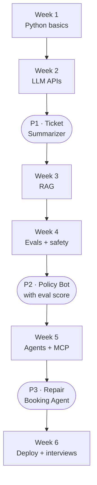

# Day 1 · The full roadmap

> *5 saal, 0 hike. Upar se "AI tumhari job kha jayega" wala darr.* Yeh Rahul ki kahani hai. Shayad tumhari bhi.

Rahul is a fictional IT support engineer: 5 years, 0 hike. Over 42 days he goes from support tickets to building 3 AI projects. You build them with him.

**The only guarantee here is proof, not a job:** by Day 42 you will have 3 AI projects on GitHub that you can explain in an interview.

## The path at a glance

## The 3 projects

| Project | Days | You will have |
|---|---|---|
| [P1 · Ticket Summarizer](../../projects/p1-ticket-summarizer) | 8 to 14 | Reads support tickets and returns category, priority and a short summary as JSON. |
| [P2 · Lala Policy Bot (RAG)](../../projects/p2-policy-bot-rag) | 15 to 28 | Answers questions from public sample policy documents, shows the source page, and reports a measured eval score. |
| [P3 · Repair Booking Agent](../../projects/p3-repair-booking-agent) | 29 to 35 | A chat agent that books a repair slot with tools, asks a human before confirming, and stops safely. |

## All 42 days

| Day | Week | Episode | What you learn | Aaj ka kaam (homework) |
|---|---|---|---|---|
| 1 | 1 | [5 saal, 0 hike: Rahul ki kahani](../day-01-roadmap) | The story, the 42-day plan, and the only guarantee: proof, not a job | Star this repo, comment START on the reel, follow for Day 2 |
| 2 | 1 | [AI Engineer asal mein karta kya hai?](../day-02-ai-engineer-kya-karta-hai) | Data Scientist vs ML Engineer vs AI Engineer | Write 3 AI features you use daily (Gmail, Swiggy, UPI): ready model or custom? |
| 3 | 1 | [Dukaan kholne se pehle: setup](../day-03-setup-python-vscode-github) | Install Python, VS Code and Git, make a GitHub account | Install all 3 and push a hello.py to your GitHub |
| 4 | 1 | [Python ka bahi khata: variables](../day-04-python-variables) | Variables and data types | Write 5 variables about your own job |
| 5 | 1 | [Godown ke racks: lists aur dicts](../day-05-lists-and-dicts) | Lists and dictionaries | Store 5 sample tickets as a list of dicts |
| 6 | 1 | [Kaam ek baar likho: loops aur functions](../day-06-loops-and-functions) | Loops and functions | Write a function that counts tickets by category |
| 7 | 1 | [Week 1 recap: files aur JSON](../day-07-files-and-json) | Reading CSV and JSON files | Read tickets.csv and print the top 3 categories |
| 8 | 2 | [API matlab waiter](../day-08-what-is-an-api) | What an API is, the requests library | Call a free public API (weather) |
| 9 | 2 | [Pehli LLM API call](../day-09-first-llm-api-call) | Calling an LLM API with a free-tier key | Send one prompt from Python and print the answer |
| 10 | 2 | [Tokens = paisa](../day-10-tokens-and-cost) | Tokens, context window, cost | Count the tokens in one ticket |
| 11 | 2 | [Chaddha sir jaisa prompt mat likho](../day-11-prompt-basics) | Prompt basics: role, task, context, format | Rewrite one bad prompt 3 ways |
| 12 | 2 | [Form bharwao: structured output](../day-12-structured-output-json) | JSON output from an LLM | Get category, priority and summary as JSON |
| 13 | 2 | [Project 1: Ticket Summarizer](../day-13-p1-ticket-summarizer) | Build P1 end to end | Run P1 on 20 sample tickets (no company data) |
| 14 | 2 | [P1 GitHub pe + Week 2 recap](../day-14-p1-readme-and-recap) | README, screenshots, what to write | Push P1 with a README |
| 15 | 3 | [Embeddings: mohalla ka address](../day-15-embeddings) | Embeddings and similarity | Embed 5 sentences and find the closest pair |
| 16 | 3 | [LLM ko company ki baat nahi pata](../day-16-why-rag) | Why RAG | List 10 questions a new joiner asks |
| 17 | 3 | [Thali parosna: chunking](../day-17-chunking) | Chunking documents | Chunk one public PDF 3 ways |
| 18 | 3 | [Library ka index: vector search](../day-18-vector-search) | Vector DB and top-k search | Store chunks and search the top 3 |
| 19 | 3 | [Vector DB hi sab kuch nahi: hybrid search](../day-19-hybrid-search) | Keyword + vector search | Add keyword search and compare results |
| 20 | 3 | [Project 2 part 1: Lala Policy Bot](../day-20-p2-policy-bot-ingest) | Ingest public sample policy docs | Ingest the docs and answer one question |
| 21 | 3 | [P2 part 2: jawab ke saath source](../day-21-p2-citations) | Citations in answers + Week 3 recap | Answers show their source page |
| 22 | 4 | [Hallucination: Chaddha ki fake news](../day-22-hallucination) | Why LLMs make things up, how to reduce it | Find 3 wrong answers in P2 |
| 23 | 4 | [Evals: 20 asli sawaal](../day-23-eval-set) | Building an eval set | Write 20 questions with correct answers |
| 24 | 4 | [P2 ka score nikalo](../day-24-p2-eval-score) | Scoring P2, fixing failures | Record your real score |
| 25 | 4 | [Reranking aur prompt fixes](../day-25-reranking-and-prompt-fixes) | Rerank, better prompt, re-run evals | Improve the score, note before vs after |
| 26 | 4 | [Lala ka bijli bill: cost aur latency](../day-26-cost-and-latency) | Cost per query, speed, caching | Measure cost and time per answer |
| 27 | 4 | [Prompt injection aur data safety](../day-27-prompt-injection-and-data-safety) | Prompt injection, never send company data | Try 3 injection prompts on P2 and add a guard |
| 28 | 4 | [Week 4 recap: P2 GitHub pe, score ke saath](../day-28-p2-readme-with-score) | README with the eval number | Push P2 with its eval score in the README |
| 29 | 5 | [Chatbot vs workflow vs agent](../day-29-chatbot-vs-workflow-vs-agent) | The difference, with examples | Classify 5 apps into the 3 types |
| 30 | 5 | [Agent ko auzaar do: tool calling](../day-30-tool-calling) | Function / tool calling | Build one tool: get_slot(date) |
| 31 | 5 | [MCP 60 second mein](../day-31-mcp-in-60-seconds) | What MCP is and why it matters | Connect one MCP server to a client |
| 32 | 5 | [Project 3: Repair Booking Agent](../day-32-p3-repair-booking-agent) | Build P3 part 1 | The agent books a slot from chat |
| 33 | 5 | [P3 part 2: guardrails + insaan ki approval](../day-33-p3-guardrails-human-approval) | Human in the loop, limits | Ask for approval before confirming |
| 34 | 5 | [Agent loop mein phas na jaye](../day-34-agent-loop-limits) | Max steps, timeouts, logs | Add max steps and logging |
| 35 | 5 | [Week 5 recap: P3 demo](../day-35-p3-demo) | Demo video + README | Record a 60 s demo of P3 |
| 36 | 6 | [Free mein live karo: deploy](../day-36-deploy-free) | Deploy one project on a free host | Get one live link |
| 37 | 6 | [README jo recruiter padhta hai](../day-37-readme-recruiters-read) | Problem, approach, result, number, demo | Rewrite all 3 READMEs |
| 38 | 6 | [Resume pe project lines](../day-38-resume-project-lines) | Action + tech + number lines | Write 3 resume lines you can defend |
| 39 | 6 | [LinkedIn headline jo search mein aaye](../day-39-linkedin-headline) | Headline, About, Featured | Update your headline and Featured section |
| 40 | 6 | [AI Engineer interview ke 5 sawaal](../day-40-interview-5-questions) | RAG, evals, hallucination, cost, agents | Answer 5 questions in 60 s each |
| 41 | 6 | [Referral DM jiska reply aata hai](../day-41-referral-dm) | Referral message + internal job portal first | Send 3 referral DMs |
| 42 | 6 | [Finale: Rahul ka interview call](../day-42-finale) | Wrap up, what next, Season 2 | Comment your project link |

## What you need

| When | What |
|---|---|
| Day 3 | A laptop, Python 3, VS Code, Git and a free GitHub account |
| Day 9 | A free-tier LLM API key (the current options are checked on Day 9) |
| Every day | About 45 to 60 minutes. Consistency beats long weekends. |

## Your progress tracker

Copy this into the README of your own repo and tick it off as you go.

### Week 1 · Python basics

- [ ] **Day 1** · 5 saal, 0 hike: Rahul ki kahani
- [ ] **Day 2** · AI Engineer asal mein karta kya hai?
- [ ] **Day 3** · Dukaan kholne se pehle: setup
- [ ] **Day 4** · Python ka bahi khata: variables
- [ ] **Day 5** · Godown ke racks: lists aur dicts
- [ ] **Day 6** · Kaam ek baar likho: loops aur functions
- [ ] **Day 7** · Week 1 recap: files aur JSON

### Week 2 · LLM APIs + Project 1

- [ ] **Day 8** · API matlab waiter
- [ ] **Day 9** · Pehli LLM API call
- [ ] **Day 10** · Tokens = paisa
- [ ] **Day 11** · Chaddha sir jaisa prompt mat likho
- [ ] **Day 12** · Form bharwao: structured output
- [ ] **Day 13** · Project 1: Ticket Summarizer
- [ ] **Day 14** · P1 GitHub pe + Week 2 recap

### Week 3 · RAG + Project 2

- [ ] **Day 15** · Embeddings: mohalla ka address
- [ ] **Day 16** · LLM ko company ki baat nahi pata
- [ ] **Day 17** · Thali parosna: chunking
- [ ] **Day 18** · Library ka index: vector search
- [ ] **Day 19** · Vector DB hi sab kuch nahi: hybrid search
- [ ] **Day 20** · Project 2 part 1: Lala Policy Bot
- [ ] **Day 21** · P2 part 2: jawab ke saath source

### Week 4 · Evals and safety

- [ ] **Day 22** · Hallucination: Chaddha ki fake news
- [ ] **Day 23** · Evals: 20 asli sawaal
- [ ] **Day 24** · P2 ka score nikalo
- [ ] **Day 25** · Reranking aur prompt fixes
- [ ] **Day 26** · Lala ka bijli bill: cost aur latency
- [ ] **Day 27** · Prompt injection aur data safety
- [ ] **Day 28** · Week 4 recap: P2 GitHub pe, score ke saath

### Week 5 · Agents + Project 3

- [ ] **Day 29** · Chatbot vs workflow vs agent
- [ ] **Day 30** · Agent ko auzaar do: tool calling
- [ ] **Day 31** · MCP 60 second mein
- [ ] **Day 32** · Project 3: Repair Booking Agent
- [ ] **Day 33** · P3 part 2: guardrails + insaan ki approval
- [ ] **Day 34** · Agent loop mein phas na jaye
- [ ] **Day 35** · Week 5 recap: P3 demo

### Week 6 · Ship and get interview-ready

- [ ] **Day 36** · Free mein live karo: deploy
- [ ] **Day 37** · README jo recruiter padhta hai
- [ ] **Day 38** · Resume pe project lines
- [ ] **Day 39** · LinkedIn headline jo search mein aaye
- [ ] **Day 40** · AI Engineer interview ke 5 sawaal
- [ ] **Day 41** · Referral DM jiska reply aata hai
- [ ] **Day 42** · Finale: Rahul ka interview call

## Aaj ka kaam (Day 1)

1. **Star** this repo and **watch** it.
2. Create your own repo for your work, for example `my-42-days-ai`.
3. Comment **START** on the Day 1 reel, and follow [@dev_with_data](https://www.instagram.com/dev_with_data/) for Day 2.

**Next: [Day 2 · AI Engineer asal mein karta kya hai?](../day-02-ai-engineer-kya-karta-hai)**
