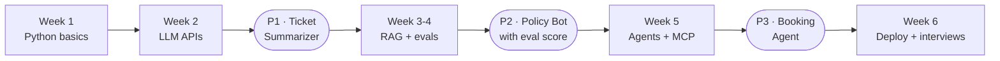

# The 42-day roadmap (you commented ROADMAP, here it is)

**One reel, one project step and the day's code. Every day.** Full day-by-day table: [Day 1 · The full roadmap](../day-01-roadmap).

## In dhaba language

| Week | You learn | Dhaba version | You walk away with |
|---|---|---|---|
| 1 | Python basics | Learn to run the kitchen | Python you can read and write |
| 2 | LLM APIs | Use the ready masala | **P1 · Ticket Summarizer** |
| 3 | RAG | Give the cook your own recipe book | **P2 · Policy Bot** (part 1) |
| 4 | Evals + safety | Taste-test every dish, lock the store room | P2 with a measured score |
| 5 | Agents + MCP | Let the waiter take actions, not just orders | **P3 · Repair Booking Agent** |
| 6 | Deploy + interviews | Open the dhaba to the public | Live link, README, resume lines |

## How to use it

1. **Star** this repo and make your own repo for your work (for example `my-42-days-ai`).
2. Every day: watch the reel, open that day's folder here, do the *aaj ka kaam*, push it to **your** repo.
3. Tick your progress with the tracker in [Day 1](../day-01-roadmap#your-progress-tracker).

> Job ki guarantee koi nahi deta. Hum plan aur proof dete hain.
